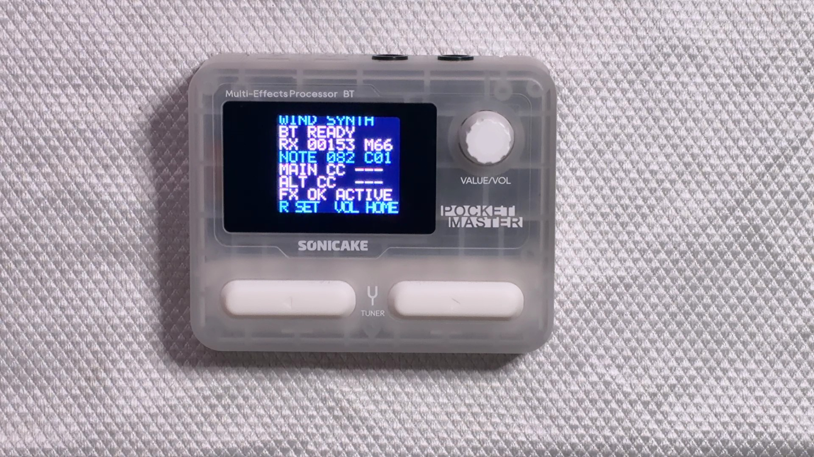
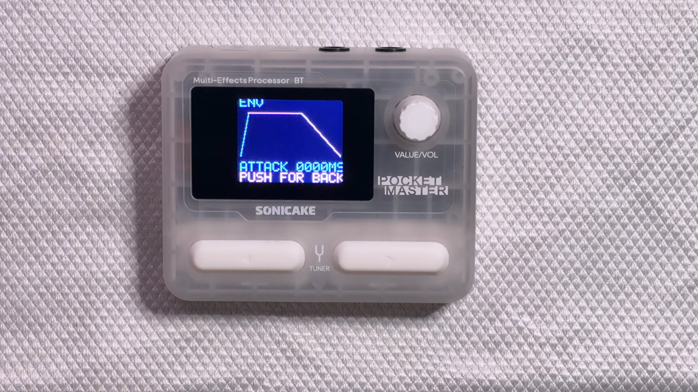
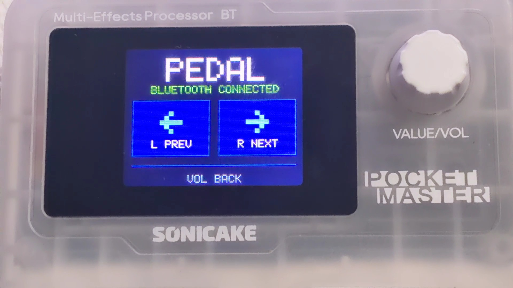

# Pocket Master Wind Synth & Pedal

[](https://youtube.com/shorts/4C6Ks2ScNWE)

**[機能紹介動画を見る（YouTube Shorts）](https://youtube.com/shorts/4C6Ks2ScNWE)**

SONICAKE Pocket Master（QME-10）に、**ウィンドシンセ音源**と**iPadの譜めくり**を追加する非公式パッチです。純正ファームウェア **V1.3.3** に適用します。

**[V5 差分パッチをダウンロード](download/Pocket_Master_Pedal_V5_Patch.zip?raw=true)**

## WIND SYNTH

BLE MIDI対応のウィンドコントローラーを接続すると、Pocket Master本体がノートや息の強さを受信して発音します。

- サイン波・ノコギリ波・矩形波を選択できます。
- フィルター、ピッチベンド、ブレスCC、ADSRエンベロープを本体で調整できます。
- シンセ音を直接出力するか、Pocket Masterの内蔵エフェクトを通すか選べます。

| 演奏画面 | ENVエンベロープ編集 |
| --- | --- |
|  |  |

## PEDAL

Pocket MasterをiPadにBluetoothキーボードとして接続し、本体の **Lで←、Rで→** を送ります。左右の矢印キーでページを切り替えられる譜面アプリで使えます。

ホーム画面で `VALUE/VOL` を長押しして `PEDAL` を選びます。iPadの「設定 → Bluetooth」で `Pocket Pedal` または `Pocket Master BLE` を選び、ポケマスに `BLUETOOTH CONNECTED` と表示されたら操作できます。



## インストール

1. [SONICAKE公式ダウンロードページ](https://www.sonicake.com/pages/pocket-master-software-firmware-download-qme-10)から、QME-10用の **純正V1.3.3** を入手し、`.bin` を展開します。
2. このページのパッチZIPを展開します。Python 3を用意し、`apply_patch.py` のあるフォルダでPowerShellを開きます。下の純正ファイルのパスを実際の保存先に置き換えて実行してください。

   ```powershell
   py -3 .\apply_patch.py 'C:\path\to\official-v1.3.3.bin' .\Pocket_Master_Pedal_V5.bin
   ```

3. `Created:` が表示されたら、生成した `Pocket_Master_Pedal_V5.bin` をSonicake Managerのファームウェア更新で選択します。

パッチZIPには差分、適用スクリプト、ソースコード、手順書を収録しています。適用スクリプトは純正ファイルと生成ファイルのSHA-256を検証します。
